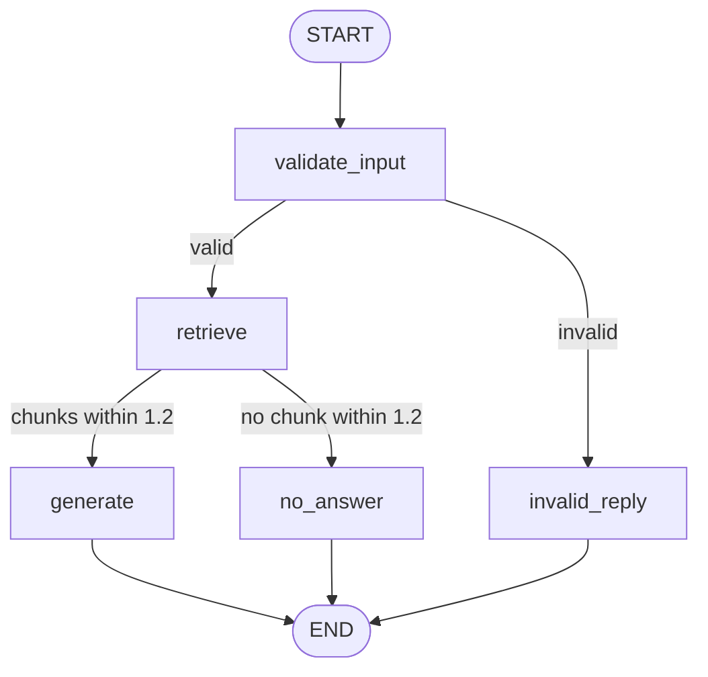

# Task 4.2 - LangGraph Workflow

## Objective
Turn the Task 4.1 RAG pipeline into an explicit LangGraph workflow with clear
state, focused nodes and conditional branches, and test the failure paths as
well as the normal path.

## Tools Used
- Python 3.11
- LangGraph 1.2.14
- Code reused from Task 4.1 (FAISS retrieval, grounded prompt, Gemini gemini-3.1-flash-lite)

## Workflow
Diagram, state table and branch rules are in [WORKFLOW.md](WORKFLOW.md).



## Work Completed
1. Built and ran a two-node practice graph (`src/hello_graph.py`)
2. Designed the workflow, state and branches before coding (`WORKFLOW.md`)
3. Implemented 5 nodes and 2 conditional edges (`src/workflow.py`)
4. Recorded the path of nodes in the state for every run
5. Tested the normal path and the failure paths

## How to Run
Needs the Task 4.1 setup first (environment, `.env`, FAISS index built with
`build_index.py`). Then, from the repository root:
```
python Week-4/Task-4.2-LangGraph-Workflow/src/workflow.py "What test accuracy did the CNN get?"
```

## Test Results (from my own runs)
| Input | Path | Answer | Result |
|---|---|---|---|
| What test accuracy did the CNN get? | validate_input, retrieve, generate | ~91.6% | Normal path works |
| ab | validate_input, invalid_reply | Asks for at least 3 characters | Invalid text handled |
| (no question) | validate_input, invalid_reply | Same message | Invalid text handled |
| 123 (a number, run through Python directly) | validate_input, invalid_reply | Same message | Non-text input handled |
| Who won the cricket world cup? | validate_input, retrieve, no_answer | "I don't know..." (all chunks above 1.2) | Out of scope handled without calling Gemini |
| What accuracy did the CNN get on CIFAR-10? | validate_input, retrieve, generate | "I don't know..." | Refusal came from the prompt, not the graph |

## Limitations
- The path records which nodes ran, not what the model said. A refusal inside
  `generate` (the CIFAR-10 case) looks like a normal run in the path.
- The 1.2 distance limit is the untuned value from Task 4.1.
- The workflow needs the Task 4.1 folder, its `.env` and its FAISS index.
- Tests were run by hand; there is no automated test suite yet.
- VS Code (Pylance) flags two unresolved imports (`rag`, `retrieve`) because the Task 4.1 folder is added to the path at run time. The code runs correctly.

## Key Learnings
1. State is the shared data; each node returns only the fields it changes.
2. Conditional edges are small functions that read the state and return a node name.
3. Recording a path makes it possible to check where a run branched.
4. A graph can only route on what it can see; some failures stay inside a node.

## Submission Status
Status: Completed
Submitted On: 11 Oct 2026