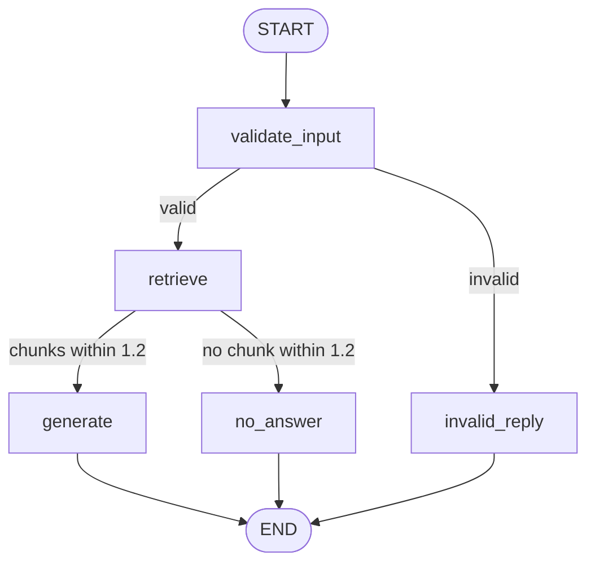

# Task 4.2 - Workflow Design

## Task
Answer a question about my project documentation using the Task 4.1 RAG
pieces, with explicit handling for invalid input and out-of-scope questions.

## Diagram

## State
| Field | Written by | Meaning |
|---|---|---|
| question | input | Raw question |
| is_valid | validate_input | True if at least 3 characters after stripping |
| results | retrieve | All retrieved chunks with distance scores |
| used | retrieve | Chunks with distance <= 1.2 |
| answer | generate / invalid_reply / no_answer | Final reply |
| path | every node | Names of the nodes that ran, in order |

## Nodes
| Node | Job |
|---|---|
| validate_input | Check the question length |
| retrieve | Search FAISS and keep chunks within the distance limit |
| generate | Ask Gemini to answer from the kept chunks only |
| invalid_reply | Return a "please type a question" message |
| no_answer | Return "I don't know based on the provided documents." |

## Branches (conditional edges)
1. After validate_input: valid goes to retrieve; invalid goes to invalid_reply.
2. After retrieve: at least one chunk within 1.2 goes to generate; none goes to no_answer.

## Expected paths (to be verified by running)
| Input | Expected path |
|---|---|
| What test accuracy did the CNN get? | validate_input, retrieve, generate |
| (empty or 2 characters) | validate_input, invalid_reply |
| Who won the cricket world cup? | validate_input, retrieve, no_answer |