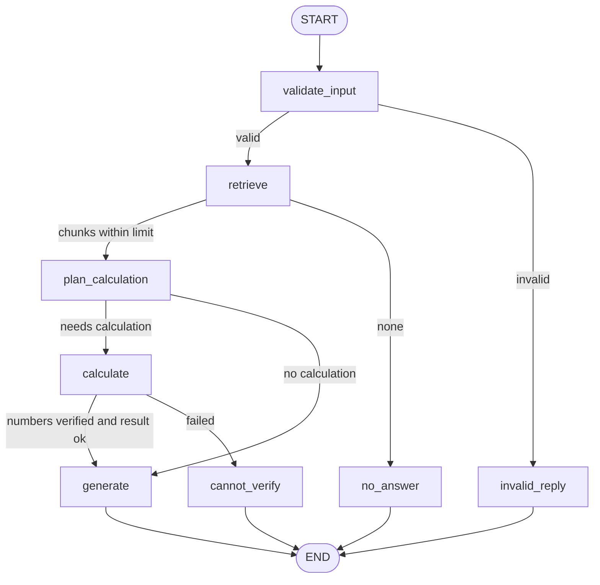

# Task 4.4 - AI Agent Capstone: Plan (written before coding)

## 1. Problem statement
I want quick, accurate answers about my internship project documentation
(results, setup, limitations) without opening many files. Some questions also
need exact arithmetic on numbers that appear in those documents.

## 2. Target users
- Me, preparing to explain my projects in an interview
- A mentor or reviewer checking my repository

## 3. Scope
The system should:
- Answer from the 7 knowledge-base files and name the source file
- Compute differences or ratios between numbers found in the documents
- Decline when information is missing or the question is out of scope
- Reject invalid input

The system should not:
- Answer general-knowledge questions
- Invent numbers or guess values that are not in the documents
- Browse the web, edit files or run code
- Act as a general-purpose assistant

## 4. User journey
1. User types a question
2. The system checks the input is usable
3. It retrieves chunks from the documentation
4. If nothing relevant is found, it declines
5. Otherwise it decides whether the question needs arithmetic
6. If yes: it proposes an expression, checks that every number in it appears
   in the retrieved text, and runs the calculator tool
7. It writes the final answer from the chunks (and the tool result) and names sources

## 5. Features
- Document question answering with sources (reused from Task 4.1)
- Branching workflow with a recorded path (reused from Task 4.2)
- One tool: `calculate` (exact arithmetic only)
- Number check before calculating (see Validation)
- Traces in LangSmith (setup reused from Task 4.3)

## 6. Architecture (diagram must match the code)

### Components
| Node | Job | Uses |
|---|---|---|
| validate_input | Check the question is text with 3+ characters | plain code |
| retrieve | Search FAISS, keep chunks within the distance limit | Task 4.1 code |
| plan_calculation | Ask Gemini: is arithmetic needed, and what expression, using only numbers in the chunks? | Gemini |
| calculate | Check every number in the expression appears in the chunks, then evaluate it safely | tool (no eval) |
| generate | Write the answer from the chunks and the tool result | Gemini |
| invalid_reply, no_answer, cannot_verify | Fixed replies for the three decline cases | plain code |

### State (fields)
question, is_valid, results, used, calc_expression, calc_result, calc_error, answer, path

### Tool
`calculate(expression)`: only numbers and + - * / and parentheses. No
variable names, no function calls, no `eval`. Anything else returns an error.

### Validation
- Input check (length and type)
- Distance limit on retrieval (starting value 1.2, still untuned)
- Number check: every number in the proposed expression must appear in the
  retrieved text, so the tool is never fed a number the model made up

## 7. Data flow
question -> validate -> chunks -> (expression) -> number check -> result ->
answer text plus sources. The path of nodes is stored in the state and shown
in LangSmith.

## 8. Failure cases to test
| ID | Type | Question | Expected | To fill |
|---|---|---|---|---|
| T1 | Normal | What test accuracy did the CNN get? | About 91.6% | path |
| T2 | Retrieval | What were the spam recall and precision for Keras and the baseline? | 0.86/0.88 and 0.71/0.99 | path |
| T3 | Tool use | By how many points did the Keras spam recall exceed the baseline recall? | 0.15 (0.86 minus 0.71) | path |
| T4 | Multi-step | How many points higher was the CNN training accuracy than its test accuracy? | About 3.9 (the files give approximate values, about 95.5 and 91.6) | path |
| T5 | Ambiguous | How did it perform? | Declines or asks what is meant (decision pending) | path |
| T6 | Missing info | What is the Offer Letter ID? | Says it cannot find a value | path |
| T7 | Out of scope | Who won the cricket world cup? | Declines | path |
| T8 | Invalid | ab | Asks for 3+ characters | path |
| T9 | Tool safety | What is 5 divided by 0 using the numbers in the docs? | Does not crash | to design |

All expected answers are written before running. Rows marked "to design" or
"decision pending" are not decided yet.

## 9. Limitations (known before building)
- The retrieval distance limit is untuned; Task 4.3 showed it can drop a relevant chunk
- The knowledge base is 7 files; anything outside them cannot be answered
- Each Gemini call took several seconds in Task 4.3; this design adds one more call
  (cost not measured yet)
- Free-tier request limits apply
- Documents give some values as approximations (for example about 91.6)

## 10. Build order (one path first)
1. The Task 4.2 path (validate, retrieve, generate) running from the capstone folder
2. Add the calculator tool and its tests on its own
3. Add plan_calculation and the number check
4. Add the failure branches
5. Run all tests, inspect traces, fix one real failure
6. README, report, slides, demo