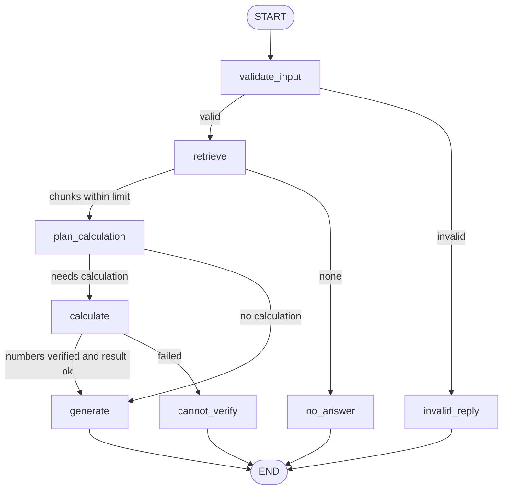

# Task 4.4 - AI Agent Capstone: Project Documentation Assistant

## Problem Statement
I want quick, accurate answers about my internship project documentation
(results, setup, limitations) without opening many files. Some questions also
need exact arithmetic on numbers that appear in those documents.

## Objective
Build a small agent that answers from my own documentation (RAG), uses one
tool for exact arithmetic, follows an explicit multi-step workflow (LangGraph),
validates what it does, and declines when it cannot answer safely.

## Scope
The agent should: answer from 7 documentation files, compute differences or
ratios between numbers found in them, decline when information is missing or
out of scope, and reject invalid input.
It should not: answer general-knowledge questions, invent numbers, browse the
web, edit files or run code.

## Features
- Question answering over 7 Markdown files (FAISS + local embeddings + Gemini)
- Branching LangGraph workflow that records the path taken for every run
- One tool, `calculate`: exact arithmetic, parsed with `ast` (no `eval`)
- Number check: every number in a calculation (except 100) must appear in the retrieved text
- Fixed replies for invalid input, out-of-scope questions and failed calculations
- Tracing with LangSmith (optional)

## Architecture

The generated graph from `agent.py` has the same 8 nodes and 4 branch points.

| Node | Job |
|---|---|
| validate_input | Question must be text with at least 3 characters |
| retrieve | FAISS search, k = 4, keep chunks with distance <= 1.2 |
| plan_calculation | Gemini returns one arithmetic expression, or NONE |
| calculate | Number check, then the safe calculator |
| generate | Gemini answers from the chunks (and the calculator result) |
| invalid_reply / no_answer / cannot_verify | Fixed replies for the three decline cases |

Design notes are in [PLAN.md](PLAN.md).

## Technologies
Python 3.11, LangChain, LangGraph, FAISS (faiss-cpu), sentence-transformers
(all-MiniLM-L6-v2), Google Gemini (gemini-3.1-flash-lite), LangSmith.

## Project Structure
```
Task-4.4-AI-Agent-Capstone/
  README.md  PLAN.md  TEST_LOG.md  requirements.txt  .env.example
  knowledge_base/   7 Markdown files (copies of my Week 2-3 READMEs)
  src/              agent.py calculator.py number_check.py rag.py retrieve.py
                    ingest.py build_index.py and three test_*.py files
  screenshots/
```
Not committed: `.env` (your keys) and `faiss_index/` (rebuilt by `build_index.py`).
The Task 4.1 and 4.2 code was copied into this folder so it runs on its own.

## Setup
From the repository root, in PowerShell:
```
python -m venv venv-week4
.\venv-week4\Scripts\Activate.ps1
pip install -r Week-4/Task-4.4-AI-Agent-Capstone/requirements.txt
Copy-Item Week-4/Task-4.4-AI-Agent-Capstone/.env.example Week-4/Task-4.4-AI-Agent-Capstone/.env
```
Open the new `.env` and add your own Google Gemini key (and optionally a
LangSmith key; set `LANGSMITH_TRACING=false` to run without LangSmith). Never
commit `.env`.

## How to Run
```
python Week-4/Task-4.4-AI-Agent-Capstone/src/build_index.py
python Week-4/Task-4.4-AI-Agent-Capstone/src/agent.py "What test accuracy did the CNN get?"
```
The first `build_index.py` run downloads the embedding model (about 90 MB).
The output shows the path of nodes, the retrieved chunks with scores, and the answer.

## Example Usage (from my own runs)
| Question | Path | Answer |
|---|---|---|
| By how many points did the Keras spam recall exceed the baseline recall? | validate_input, retrieve, plan_calculation, calculate, generate | "...exceeded the baseline recall by 0.15 points." (expression 0.86 - 0.71) |
| How much higher was the Keras spam F1 than the baseline F1, as a percentage of the baseline? | validate_input, retrieve, plan_calculation, calculate, generate | "approximately 5.55% higher..." (expression (0.8726 - 0.8267) / 0.8267 * 100) |
| Who won the cricket world cup? | validate_input, retrieve, no_answer | "I don't know based on the provided documents." |

## Results and Testing
Full log with expected results written before the runs: [TEST_LOG.md](TEST_LOG.md).

| Test | Result |
|---|---|
| Normal, retrieval, tool use, multi-step (T1-T4) | Pass (T3 unit wording unclear; T4 states approximate values as exact) |
| Ambiguous, missing information (T5, T6) | Safe declines, not helpful (see Limitations) |
| Out of scope, invalid input (T7, T8) | Pass |
| Division by zero (T9) | Stopped at the retrieval gate; tool safety is covered by the stand-in tests |
| Percentage question (T10) | Failed before one fix, passed after |

Automated checks in `src/`: `test_calculator.py` (17 cases), `test_number_check.py` (12 cases),
`test_agent_branches.py` (6 cases using a stand-in model, no API calls).
Latency in LangSmith before the T10 fix: about 0.1 s when the graph stops before Gemini,
about 2.6 s to 11.6 s when it calls Gemini (one or two runs per question, free tier, so
differences between questions are not meaningful).

## Known Failure Modes and Limitations
- The retrieval distance limit (1.2) is untuned and can drop a relevant chunk (T6: Offer Letter ID).
- The number check blocks every constant except 100; 100 is allowed anywhere in an expression.
- Answers may report the wrong unit ("0.15 points" for a 15 percentage-point gap) or state approximate values as exact.
- Answers do not say which baseline was used; the spam file has two (4,136 and 3,515 train).
- Ambiguous questions get a bare decline instead of a clarifying question.
- The planning call runs for every answerable question, which adds one Gemini call and its tokens.
- 7 knowledge-base files only; one run per question; tested on Windows with Python 3.11 only.
- Free Gemini tier: request limits apply, and inputs may be used to improve Google products.
- A fresh-clone run of this README has not been done yet.

## Future Improvements
- Tune the distance limit with more questions
- Ask a clarifying question for ambiguous input
- Skip the planning call for questions with no numbers
- Name the baseline and the unit in numeric answers
- Run the setup steps on a fresh clone and a second machine

## Deliverables Status
| Deliverable | Status |
|---|---|
| GitHub repository | In progress |
| Live demo | Not done (format to be confirmed) |
| Project report | Not done |
| Presentation slides | Not done |

## Submission Status
Status: In Progress
Submitted On: