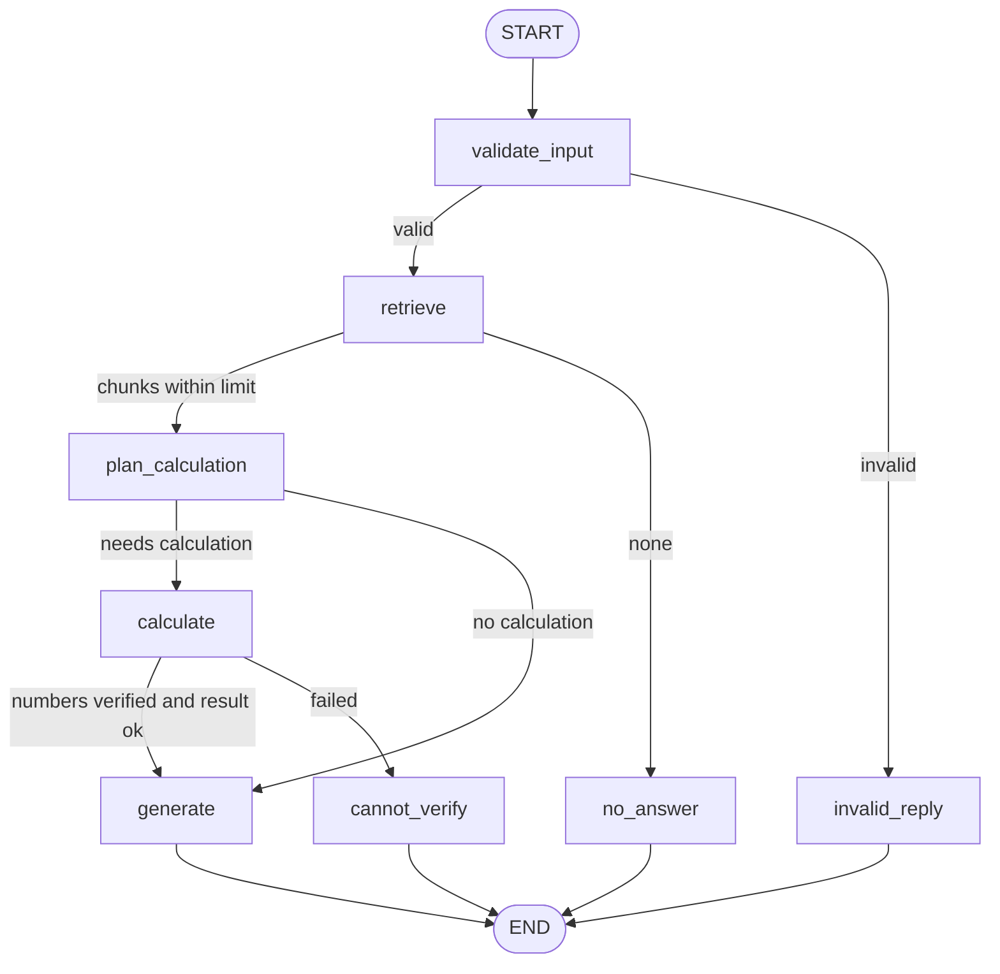

# Project Report - Project Documentation Assistant (Task 4.4)

## 1. Problem and scope
I want quick, accurate answers about my internship project documentation
(results, setup, limitations) without opening many files. Some questions also
need exact arithmetic on numbers that appear in those documents.

The agent should: answer from 7 documentation files, compute differences or
ratios between numbers found in them, decline when information is missing or
out of scope, and reject invalid input.
It should not: answer general-knowledge questions, invent numbers, browse the
web, edit files or run code.

## 2. Architecture

| Node | Job | Why it exists |
|---|---|---|
| validate_input | Question must be text with at least 3 characters | Stops empty or non-text input before any search |
| retrieve | FAISS search, k = 4, keep chunks with distance <= 1.2 | Finds the documentation the answer must come from |
| plan_calculation | Gemini returns one arithmetic expression, or NONE | Decides whether the question needs exact arithmetic |
| calculate | Number check, then a safe calculator | Does the arithmetic exactly, and only on numbers found in the documents |
| generate | Gemini answers from the chunks and the calculator result | Writes the final answer |
| invalid_reply / no_answer / cannot_verify | Fixed replies | Three safe ways to decline |

The graph printed by LangGraph from `agent.py` has the same 8 nodes and 4 branch points as this diagram.

## 3. How it was built
Built in this order, testing each piece before adding the next:
1. The Task 4.2 path (validate, retrieve, generate) running from this folder
2. The calculator tool, tested alone (17 cases)
3. The number check, tested alone (12 cases)
4. The graph with the tool, tested with a stand-in model for the rare branches (6 cases)
5. Real-model tests T1 to T10

## 4. Testing and results
Expected results were written before the runs (`TEST_LOG.md`).

| ID | Type | Question | Path | Answer | Result |
|---|---|---|---|---|---|
| T1 | Normal | What test accuracy did the CNN get? | validate_input, retrieve, plan_calculation, generate | About 91.6% | Pass |
| T2 | Retrieval | Spam recall and precision for Keras and the baseline | same | Keras 0.86 / 0.88, baseline 0.71 / 0.99 | Pass |
| T3 | Tool use | By how many points did the Keras spam recall exceed the baseline recall? | ..., calculate, generate | 0.15 (expression 0.86 - 0.71) | Pass on the number; unit wording unclear; baseline is the 4,136-train model (F6) |
| T4 | Multi-step | How many points higher was the CNN training accuracy than its test accuracy? | ..., calculate, generate | 3.9 (expression 95.5 - 91.6) | Pass on the number; stated without "about" although the files give approximate values |
| T5 | Ambiguous | How did it perform? | validate_input, retrieve, no_answer | "I don't know..." | Safe decline; does not ask what "it" means |
| T6 | Missing info | What is the Offer Letter ID? | validate_input, retrieve, no_answer | "I don't know..." | Decline; the right chunk was dropped by the 1.2 limit (F3) |
| T7 | Out of scope | Who won the cricket world cup? | validate_input, retrieve, no_answer | "I don't know..." | Pass |
| T8 | Invalid | ab | validate_input, invalid_reply | Asks for at least 3 characters | Pass |
| T9 | Tool safety | What is 5 divided by 0 using the numbers in the docs? | validate_input, retrieve, no_answer | "I don't know..." | Stopped at the retrieval gate; the tool was not reached. Tool safety is covered by the stand-in tests |
| T10 | Percentage | Keras F1 higher than the baseline F1, as a percentage of the baseline | before the fix: ..., calculate, cannot_verify; after: ..., calculate, generate | After: "approximately 5.55% higher" (result 5.552195) | Fail before the fix, pass after (F1) |

Automated checks: `test_calculator.py` (17 cases), `test_number_check.py` (12 cases),
`test_agent_branches.py` (6 cases with a stand-in model that makes no API calls); all passed.

## 5. Failures found and what was done

**F1 - T10 false decline (fixed).** A percentage question ended at cannot_verify even though it is answerable. The number check required every number in the expression to appear in the retrieved text, and 100 (needed for a percentage) never does. Fix: `number_check.py` now allows the constant 100 and nothing else, with two new test cases. Re-test: the same question now runs through calculate and generate (result 5.552195). Limitation remaining: any other constant is still blocked, and 100 is allowed anywhere in an expression.

**F2 - T3 unit wording (not fixed).** The Keras recall minus the baseline recall was reported as "0.15 points". The recall values are fractions (0.86 and 0.71), so the gap is 15 percentage points. Limitation remaining: yes.

**F3 - T6 Offer Letter ID (not fixed).** A bare "I don't know". The chunk with the blank Offer Letter ID ranked first but scored 1.414, above the 1.2 limit, so it was dropped before the model saw it. Limitation remaining: yes.

**F4 - T4 approximate values (not fixed).** The answer states 3.9 without "about", but the CNN file gives approximate values (about 95.5 and 91.6). Limitation remaining: yes.

**F5 - T5 ambiguous question (design decision pending).** A safe decline that does not ask what "it" means. Limitation remaining: yes.

**F6 - Baseline choice in T3 and T10 (not fixed).** Both answers compared Keras with the TF-IDF model trained on 4,136 messages. The spam file also lists a 3,515-train TF-IDF model and calls it the like-for-like comparison with Keras. Limitation remaining: yes.

## 6. Observability with LangSmith
Runs were traced in the LangSmith project `week4-capstone` (free plan; traces are kept for 14 days, so screenshots are saved in `screenshots/`).
- Runs that stop before Gemini (invalid input, out of scope, retrieval gate) took about 0.1 s (0.09 s to 0.11 s in the list).
- Runs that call Gemini took between 2.60 s and 11.62 s in the list. Each question was run once or twice, so the differences between questions are not meaningful.
- The planning step added a second model call: the CNN question used 619 tokens in the earlier one-call version and 1.244K tokens in the agent version, although it needs no calculation.
- The trace shows each node as a separate step, which made it possible to see where a run left the graph.

## 7. Reproducibility
A fresh clone was tested once on one Windows machine: install from `requirements.txt` into a new environment, model download (about 90 MB), index rebuild (64 chunks), and three questions all matched the laptop runs. Finding: with tracing on and a placeholder LangSmith key the agent answered correctly but printed repeated 403 errors, so `.env.example` now defaults to `LANGSMITH_TRACING=false`. `langchain-core` is not pinned (1.6.7 on my laptop, 1.6.9 in the clone); the three test questions gave identical results.

## 8. Limitations and future improvements
Limitations:
- The retrieval distance limit (1.2) is untuned and can drop a relevant chunk.
- The number check blocks every constant except 100, and 100 is allowed anywhere in an expression.
- Answers may report the wrong unit or state approximate values as exact, and do not say which baseline was used.
- Ambiguous questions get a bare decline instead of a clarifying question.
- The planning call runs for every answerable question, which adds one Gemini call and its tokens.
- 7 knowledge-base files only; one or two runs per question; one Windows machine tested.
- Free Gemini tier: request limits apply, and inputs may be used to improve Google products.

Future improvements:
- Tune the distance limit with more questions
- Ask a clarifying question for ambiguous input
- Skip the planning call for questions with no numbers
- Name the baseline and the unit in numeric answers
- Test on a second machine

## 9. What I learned
Retrieval and generation can fail separately. For example, for the Offer Letter ID question the right chunk was found at rank 1, but its distance (1.414) was above my 1.2 limit, so it was dropped and Gemini never saw it. The answer was "I don't know", and the cause was in the retrieve step, not in the model. Opening the retrieve step in LangSmith is what showed me this.
The calculator has a number check because the model could propose a number that is not in the documents. The check makes sure every number in the expression appears in the retrieved text. The percentage question (T10) showed that it can be too strict: 100 is not in the documents, so a valid question was blocked until I allowed that one constant.
Testing with a stand-in model showed me that rare branches such as cannot_verify can be tested on demand, which the real model would not produce reliably. That test also showed that a bad expression, including a code-injection attempt, is rejected by the calculator and never runs.
One thing I would do differently is skip the planning call for questions with no numbers: it added a second model call, and the CNN question went from 619 tokens to 1.244K. I would also make numeric answers name the unit and the baseline, because "0.15 points" and the 4,136-train baseline were both unclear.